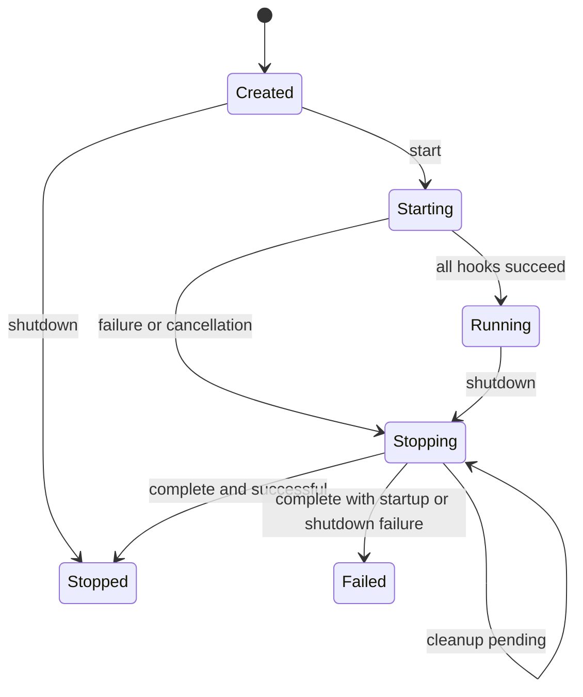

# A01 core lifecycle contracts

Status: implemented in GW-A01. See the checkpoint report for actual validation;
Windows/macOS and owner acceptance are separate gates. No domain service,
network listener, GUI, crypto provider, model backend or worker pool is added.

## Ownership and composition

`Application` owns its default steady clock, stop source, resource admission,
immutable `ApplicationContext`, and `ServiceManager`. Member destruction keeps
the context, admission, stop state and clock alive until all services are gone.
An externally supplied logger and optional injected clock must outlive Application.
The logger's stream must in turn outlive the logger. Neither application nor
manager is movable or copyable.

The context owns const copies of configuration, resolved paths and role, plus
references to logger, clock and admission and a copy of the standard stop token.
It exposes no service lookup or stop source. Domain dependencies are constructor
references supplied by the composition root, with matching declared service IDs.
The same context and lifecycle run under each of the four existing CLI targets.

Application registers `application_paths_service` (ID 1): it runs the real A00
directory initialization during managed startup. It owns no transient file
handles after initialization. Its stop hook consequently has nothing to close;
created directories are retained. This is not a secure-store implementation.
Future services may declare this ID as a prerequisite. Other nonzero IDs are
local developer-assigned identifiers, not names, principal IDs or authority.

## Public module contracts

| Module | Ownership / lifetime | Thread model | Validation / errors | Security / resources / platform | Dependencies |
|---|---|---|---|---|---|
| application_context.hpp | Application owns immutable config/path snapshots; facilities borrowed until all services destroyed | Snapshot getters read-only; referenced logger/admission have their own synchronization | Construction copies values; Application validates config before startup | Nonsecret config only; no registry or key handle; no native types | config, paths, logger, clock, admission, std stop token |
| service.hpp | Manager owns Service by unique_ptr; services own their work, completions and callback registrations | start/stop/destruction on owner thread; workers may only use explicitly thread-safe facilities | start/stop return Result; stop must handle partial start and retries | Trusted in-process code; no detached thread; deadline is cooperative | context, clock, Result |
| service_manager.hpp | Consumes registration ownership on success AND rejection; retains all accepted objects until destruction | Graph/state/report/snapshot owner-thread only; request_stop is thread-safe | Duplicate/null/zero ID/dependency bounds/cycles/missing deps/state/timeout errors; fixed reports | 64 services, 16 dependencies each; no ambient lookup; redacted structural diagnostics | Service and core facilities |
| clock.hpp | Application owns default SteadyClock or borrows injected Clock | now() must be thread-safe, noexcept, monotonic | Deadline factory rejects negative or >60,000 ms; addition saturates at max time point | No wall-clock deadlines or sleep/poll loops; injected clock must remain in same domain | std chrono, Result |
| resource_admission.hpp | Application owns controller; move-only WorkLease shares only accounting state | Controller methods synchronized; each individual lease requires exclusive ownership | Closed/cancelled/capacity/overflow/state/budget errors | Declared active/queued slots and bytes only; no allocator/RSS enforcement or executor | value limits, Result, std mutex/stop token |
| application.hpp | Composition owns Application and injects Logger/optional Clock; application owns service graph | Lifecycle owner-thread; request_stop/stop_token cross-thread | Preserves exit codes; managed startup failure never logs startup success | Ordinary role isolation and privacy-aware logging preserved | ServiceManager, platform capability/path adapters |

## Graph and startup

Registration copies the bounded dependency span. The service is consumed even
on rejection, so its destructor must be safe before startup. Constructors must
not start background work or acquire resources that require peer services.
Callers may inspect `initialization_order()` before startup without side effects.

Kahn ordering selects the lowest ready numeric ID at each step. Missing edges
and cycles reject the entire graph before any service hook or filesystem work.
The graph freezes once startup or shutdown is attempted. A manager/context pair
must share the same stop state. Application config and resource policy are
validated before initialization. Registration itself does not initialize code.

Startup opens admission after graph validation, then initializes in dependency
order. Before invoking a hook, that entry is marked cleanup-pending. A failed or
throwing start therefore receives stop just like earlier successful starts; later
services never start. Cancellation is checked before each hook and after the
last hook. Failure requests cancellation and uses the configured shutdown budget
for rollback. Startup itself is cooperative and has no preemptive time limit.

Return errors expose fixed messages, known exit-code categories, ErrorReason and
local service/dependency IDs. Service-provided error text and exception text are
never copied into lifecycle errors, logs or snapshots. Out-of-memory and fatal
process failures cannot be made generally recoverable by this API.

## Shutdown, retry and destruction

`shutdown(timeout)` accepts 0..60,000 ms (default 5,000 ms). Invalid values return
an error without changing state. It computes ONE absolute monotonic deadline
before stop callbacks run. Admission closes first, then the application stop
source is requested. Callbacks must be noexcept, short and nonblocking; never
join workers or invoke lifecycle methods from a stop callback.

Hooks run in reverse topological order and share that same deadline. A hook
must use the remaining duration for waits. When no time remains it may only
attempt immediate, nonblocking cleanup. It must not start another full-duration
wait. A successful stop asserts that all service work/completions are joined or
drained and reservations released. A returned error or exception leaves it
cleanup-pending. Its direct and transitive dependencies remain live; independent
branches may still stop. A later explicit shutdown retries unfinished hooks
with a new bounded deadline. Successfully stopped hooks are never called again.

The manager records overruns even when a hook returns success late. It also
rejects a clean-shutdown claim while global work leases remain outstanding.
`ShutdownReport.complete` means ownership can be safely torn down under service
contracts, not that the attempt was timely or error-free. A complete overrun
keeps its failed result on repeated shutdown. An incomplete retry replaces the
last attempt's report; the original startup error remains separately available.
`ServiceDiagnostic.last_failure` is historical and may remain set after retry.

Invalid graph/budget validation can enter Failed without starting any service.
There is no restart: create a new Application for another run. Reentrant calls
from hooks return invalid_state. The owner-thread rule is a caller contract,
not an invitation to call graph methods concurrently. Copy snapshots on the
owner thread before handing them to observers.

Destruction attempts explicit shutdown and then destroys service objects in
reverse dependency order. Never-started valid graphs use the same destruction
ordering; invalid graphs fall back to reverse registration. A service destructor
must be safe after failed/partial startup and must not dereference unstarted
peers. Destructors must not throw. They are the final RAII safety guard for work
that an explicit shutdown could not drain.

**The time budget is a cooperative contract, not forced termination.** C++20
cannot safely interrupt an arbitrary blocking hook, stop callback or destructor.
An uncooperative in-process service can overrun the deadline; its destructor can
block while joining. The manager never detaches or frees a live dependency to
pretend it met a hard limit. Hard isolation for untrusted code requires a future
owned-process boundary. No such process control or untrusted plugin is in A01.

## Admission and backpressure

`ResourceAdmission` starts closed; `open()` succeeds once. `close()` is terminal,
including before open. Admission and promotion after close fail. Standard stop
tokens provide per-operation cancellation checks. Races are linearized under a
short mutex: work accepted just before close remains reserved until released.
No callback is invoked under the admission lock.

`try_acquire(active|queued, bytes)` reserves one slot and declared bytes together.
Insufficient capacity returns resource_exhausted immediately; there is no hidden
queue or waiting producer. `WorkLease::try_activate()` atomically exchanges a
queued slot for an active slot without reserving memory twice. Failed promotion
leaves the reservation queued. Move assignment releases the old lease first;
release/destruction releases exactly once. Byte checks use subtraction before
addition, avoiding wraparound even at size_t maximum. Counters saturate.

Leases may outlive the controller safely because they retain only the accounting
state; they cannot reopen it or promote after owner destruction. This protects
accounting lifetime, not the lifetime of payloads or borrowed application data.
Service-owned work still must finish before service destruction.

Application uses Config.worker_limit and Config.queue_limit plus explicit
ApplicationOptions.resources. Defaults: 64 MiB of declared bytes and 20% CPU
headroom. Active capacity is min(worker_limit, max(1, N - ceil(N * headroom/100))).
N is the coarse local logical-processor count, with unknown treated as one.
The single-CPU minimum is one active slot. Headroom is a concurrency policy,
not a CPU-utilization percentage guarantee; memory is accounting, not a process
RSS cap. No hardware serial numbers or telemetry are collected.

Schema 1 and its accepted keys/ranges remain unchanged. Memory/headroom and the
shutdown timeout are composition options in A01, not new config-file keys.
There is no scheduler, fairness guarantee, queue payload, executor or GPU
allocator. Future GPU reservations need backend/device/VRAM capability and
privacy-aware scheduling decisions, recorded in FUTURE_FEATURES.md.

## A03 composition addition

All four ordinary bootstraps explicitly register a real CryptoService (ID 2)
in addition to the existing path initializer. Provider creation validates limits,
initializes the pinned backend and probes actual OS entropy. A failed creation
returns a fixed lifecycle error and follows existing rollback rules; it does not
log backend text or report ready. Help/version/check-config/print-paths still
return before these startup effects. No CLI/config option or context registry is
added. Future consumers inject a provider reference and declare its service ID.
They stop and join before this dependency is destroyed. Busy provider shutdown
returns outstanding_work, retaining ownership for retry. See CRYPTO_PROVIDER.md
for nonce, memory, cancellation, budget and destruction constraints.
