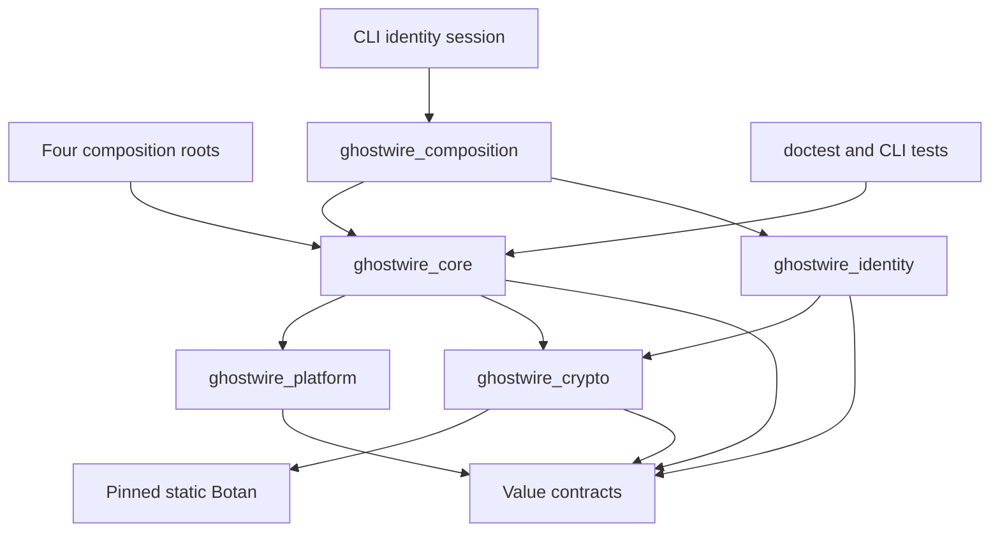

## A05-P02 compiled dependency addition

`ghostwire_protocol` is a new independent leaf library (public aliases
`GhostWire::protocol`). It depends only on `ghostwire_contracts` (value-only
headers), and `ghostwire_options` for private warnings/sanitizer configuration.
It does not link `identity`, `crypto`, `core` implementation, `platform`,
`composition`, any UI, or any socket. Test-only `ghostwire-protocol-tests` links
`GhostWire::identity` to demonstrate that A04 signature/trust validation is
separate; this does **not** add a production dependency. The boundary checker
rejects prohibited protocol imports and reverse `core -> protocol` imports.

# Dependency graph

## P03 scoped update

P03 retains the P02 graph unchanged; membership deletion hardening is internal
to identity. No new library, dependency or reverse edge is introduced.

An arrow means “may depend on”. No reverse edges or implicit service lookup.

A04-P02 adds identity and a separate composition adapter above core. The prior
platform and crypto edges are preserved; no public native types or service
registry is introduced. The CLI opts into the new adapter for its interactive
session; the ordinary four-role bootstrap remains profile-free.

`ghostwire_contracts` is a CMake INTERFACE target for C++20 and public include
paths. The platform implementation may include only core/error.hpp,
core/result.hpp and core/resource_limits.hpp, alongside platform contracts.
These are header-only values; platform never links the core implementation.
`tools/check_boundaries.py` enforces these current include boundaries and rejects
UI imports from core/platform/crypto/identity. Crypto may include only core/result.hpp
among core headers; it links no core implementation or platform target. Botan's
native RNG/memory code stays private. Identity uses only the allowed header-only
core values/Clock contract; it links crypto and contracts, never core or
permissions implementation. Composition links core plus identity. Public headers
reject backend/native types.

Future permitted edges (not existing CMake targets):

| Module | Dependencies it may use | Excluded |
|---|---|---|
| protocol | core values, schema codecs | UI, vault, sockets, crypto key storage |
| permissions | core values and immutable identity references | transport internals, UI |
| vault | crypto, platform secure storage, reviewed database | network callbacks, UI state |
| storage | core quotas, platform filesystem | plaintext private messages |
| transport | protocol, core, endpoint privacy policy, platform I/O | vault decryption, UI |
| discovery | identity verification, transport policy, protocol | chat content, vault master keys |
| messaging | identity, crypto protocol adapter, vault, protocol, transport | renderer, generic raw sockets |
| friends | identity/trust, vault, scoped discovery | community membership requirement |
| groups | reviewed group protocol adapter, identity, permissions, messaging | automatic host plaintext access |
| communities/federation | protocol, transport, permissions, storage | member root keys/DM plaintext |
| files | crypto chunk adapter, storage, permissions, transport | bypass sockets, executable attachments |
| media | permissions, transport policy, reviewed codecs/media protocols | automatic ICE bypass |
| moderation | permissions, authorized evidence, audit contracts | implicit private-history ingestion |
| AI/plugins | scoped service facade, permissions, identities | raw vault handles, unrestricted host pointers |
| diagnostics | redacted snapshots from services | unrestricted key/content dumps |
| desktop UI | application facades, platform/UI services | protocol policy overrides |

Future services communicate through explicit injected facades and bounded
immutable messages. A01 ServiceManager owns lifecycle registrations and provides no service lookup.
It must not become ambient authority available from arbitrary network handlers.

## A04-P02 identity ownership

Accepted ADR-008 fixes identity's edge: identity uses crypto and value contracts;
permissions consumes immutable public identity values, never the reverse edge.
The lifecycle adapter belongs at composition level and links core plus identity.
Core does not link back to that adapter/identity, and identity does not include
ApplicationContext or ServiceManager. CryptoService is explicitly injected into
the adapter and retained until identity consumers stop. CMake and the boundary
checker enforce these directions. See [IDENTITY_DESIGN.md](IDENTITY_DESIGN.md)
for the implemented owner-thread, time, cancellation and resource contracts.

| Owner | Owns or borrows | Constraint |
|---|---|---|
| ServiceManager | IdentityServiceAdapter, ID 3 | Explicit dependency on injected CryptoService, ID 2; reverse cleanup |
| IdentityServiceAdapter | unique_ptr IdentityService and application WorkLease | One declared active reservation; not an RSS/CPU guarantee; no profile created at start |
| IdentityService | Profile/membership keys, pins, current DeviceSets and revision/conflict state | Volatile owner-thread mutation, bounded counts/bytes, no generic signing/export |
| LocalHandle | Empty service-owner token plus slot/generations | Cannot retain service/private keys; stale/cross-service/cross-profile use denied |
| CLI Session | Explicit selected profile handle and bounded input | Owns no private key, file store, thread or network; public disclosure is opt-in |
| Trusted composition caller | Borrowed monotonic Clock and explicit UTC VerificationTime | Both supplied independently; no steady-clock reinterpretation or automatic trusted time recovery |

## A01 runtime ownership and dependencies

All new lifecycle code is in ghostwire_core; compile-time target edges above
are unchanged. resource_limits.hpp remains value-only for the platform allowlist;
resource_budget() is declared in resource_admission.hpp and implemented in core.

| Owner / caller | Owns or borrows | Constraint |
|---|---|---|
| Application | Owns clock (default), stop source, admission, context, manager | Explicit injected logger/clock outlive Application |
| ApplicationContext | Owns const config/paths/role; borrows logger/clock/admission | No generic domain-service lookup or stop-source exposure |
| ServiceManager | Owns unique_ptr services and bounded dependency declarations | Deterministic topological startup; reverse cleanup/destruction |
| ApplicationPaths service | Uses context paths and platform directory adapter | Real existing filesystem work; no secure-storage claim |
| Domain service (future) | Receives constructor references plus declared IDs | Dependency graph is lifecycle ordering, not an authorization grant |
| WorkLease | Owns reservation in shared accounting state | No payload ownership, executor or borrowed context lifetime extension |

See [CORE_LIFECYCLE.md](CORE_LIFECYCLE.md) for complete contracts.

## A02 runtime ownership

Compile-time arrows and the platform core-value allowlist are unchanged. Native
process, stop and capability APIs link only platform/contracts/system libraries.
No new third-party runtime dependency is added.

| Owner | Owned resources | Constraint |
|---|---|---|
| Caller / application service | unique_ptr Process | No adopted PID; destruction cannot race callers; service retains dependencies until cleanup |
| Process | Direct child, group/job, pipes, joined monitor | Synchronized operations, bounded captures/waits, no detached monitor |
| Bootstrap / future event loop | ProcessStopBridge registration and stop source | One owner thread dispatches; restricted callbacks only latch atomic state |
| Capability probe call | Temporary native library reference | Local API discovery only; no secret-store session or persistence authority |

See [PLATFORM_ABSTRACTIONS.md](PLATFORM_ABSTRACTIONS.md). A platform adapter does
not perform service lookup and service dependency IDs are not permissions.

## Future A05 dependency proposal (not compiled in P01)

`apps/composition -> protocol` and independently `apps/composition -> identity -> crypto`;
`protocol` may use only public header-level core result/resource contracts.
No `identity -> protocol`, `protocol -> crypto` for signature verification,
`core -> protocol` service graph dependency, or transport/UI reference is added.
The A04 signature validator stays in identity and receives complete bytes only
under an explicit caller-selected trust scope. See PROTOCOL_SCHEMA.md.

## A03 runtime ownership

The current DAG adds core -> crypto -> Botan/contracts. The earlier A01/A02
paragraphs describe those checkpoints' historical edges, not the complete A03 DAG.
core::Result<T,E> is a header-only value; its default core error remains unchanged.
Both dependency modes use one exact pinned static runtime provider (ADR-006).

| Owner | Owns or borrows | Constraint |
|---|---|---|
| ServiceManager | CryptoService, ID 2 | Actual provider initialization and rollback; no service lookup |
| CryptoService | unique_ptr CryptoProvider | Terminal stop; busy cleanup retains provider until retry |
| CryptoProvider | Backend state, stop source, limits and admission mutex | No implicit executor; simultaneous calls fail busy |
| Secret/key allocation | Clearing bytes and shared accounting | Move-only; may outlive provider; no generic serialization |
| Future consumer service | Explicit borrowed provider reference | Declare dependency, stop/join all callers before owner teardown |

See [CRYPTO_PROVIDER.md](CRYPTO_PROVIDER.md) for bounds, nonce obligations,
public-message-only signing, threading, error and secure-memory limitations.
