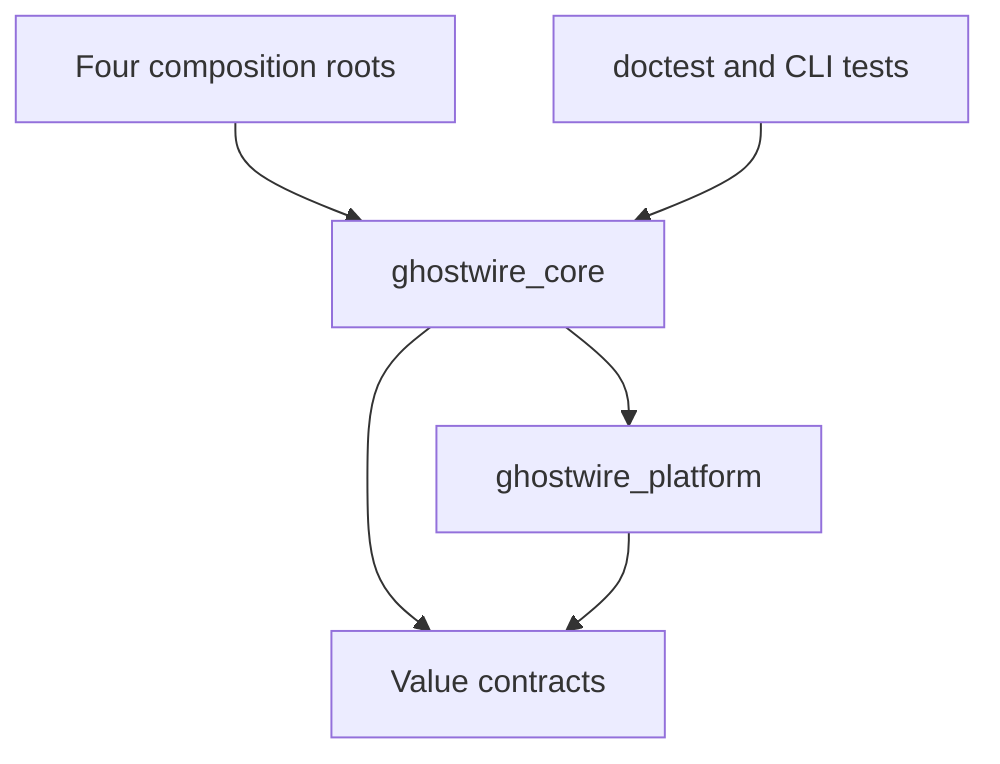

# Dependency graph

An arrow means “may depend on”. No reverse edges or implicit service lookup.

`ghostwire_contracts` is a CMake INTERFACE target for C++20 and public include
paths. The platform implementation may include only core/error.hpp,
core/result.hpp and core/resource_limits.hpp, alongside platform contracts.
These are header-only values; platform never links the core implementation.
`tools/check_boundaries.py` enforces these current include boundaries and rejects
UI imports from core/platform. Future extension must refine the check explicitly.

Future permitted edges (not existing CMake targets):

| Module | Dependencies it may use | Excluded |
|---|---|---|
| crypto | core values, platform secure memory/RNG adapter, reviewed provider | UI, community admin, transport routing |
| identity | crypto, permissions, protected key store | hardware serials as identity, UI |
| protocol | core values, schema codecs | UI, vault, sockets, crypto key storage |
| permissions | core values and immutable identity references | transport internals, UI |
| vault | crypto, platform secure storage, reviewed database | network callbacks, UI state |
| storage | core quotas, platform filesystem | plaintext private messages |
| transport | protocol, core, endpoint privacy policy, platform I/O | vault decryption, UI |
| discovery | identity verification, transport policy, protocol | chat content, vault master keys |
| messaging | identity, crypto protocol adapter, vault, protocol, transport | renderer, generic raw sockets |
| friends | identity/trust, vault, scoped discovery | community membership requirement |
| groups | reviewed group protocol adapter, identity, permissions, messaging | automatic host plaintext access |
| communities/federation | protocol, transport, permissions, storage | member root keys/DM plaintext |
| files | crypto chunk adapter, storage, permissions, transport | bypass sockets, executable attachments |
| media | permissions, transport policy, reviewed codecs/media protocols | automatic ICE bypass |
| moderation | permissions, authorized evidence, audit contracts | implicit private-history ingestion |
| AI/plugins | scoped service facade, permissions, identities | raw vault handles, unrestricted host pointers |
| diagnostics | redacted snapshots from services | unrestricted key/content dumps |
| desktop UI | application facades, platform/UI services | protocol policy overrides |

Future services communicate through explicit injected facades and bounded
immutable messages. A01 ServiceManager owns lifecycle registrations and provides no service lookup.
It must not become ambient authority available from arbitrary network handlers.

## A01 runtime ownership and dependencies

All new lifecycle code is in ghostwire_core; compile-time target edges above
are unchanged. resource_limits.hpp remains value-only for the platform allowlist;
resource_budget() is declared in resource_admission.hpp and implemented in core.

| Owner / caller | Owns or borrows | Constraint |
|---|---|---|
| Application | Owns clock (default), stop source, admission, context, manager | Explicit injected logger/clock outlive Application |
| ApplicationContext | Owns const config/paths/role; borrows logger/clock/admission | No generic domain-service lookup or stop-source exposure |
| ServiceManager | Owns unique_ptr services and bounded dependency declarations | Deterministic topological startup; reverse cleanup/destruction |
| ApplicationPaths service | Uses context paths and platform directory adapter | Real existing filesystem work; no secure-storage claim |
| Domain service (future) | Receives constructor references plus declared IDs | Dependency graph is lifecycle ordering, not an authorization grant |
| WorkLease | Owns reservation in shared accounting state | No payload ownership, executor or borrowed context lifetime extension |

See [CORE_LIFECYCLE.md](CORE_LIFECYCLE.md) for complete contracts.

## A02 runtime ownership

Compile-time arrows and the platform core-value allowlist are unchanged. Native
process, stop and capability APIs link only platform/contracts/system libraries.
No new third-party runtime dependency is added.

| Owner | Owned resources | Constraint |
|---|---|---|
| Caller / application service | unique_ptr Process | No adopted PID; destruction cannot race callers; service retains dependencies until cleanup |
| Process | Direct child, group/job, pipes, joined monitor | Synchronized operations, bounded captures/waits, no detached monitor |
| Bootstrap / future event loop | ProcessStopBridge registration and stop source | One owner thread dispatches; restricted callbacks only latch atomic state |
| Capability probe call | Temporary native library reference | Local API discovery only; no secret-store session or persistence authority |

See [PLATFORM_ABSTRACTIONS.md](PLATFORM_ABSTRACTIONS.md). A platform adapter does
not perform service lookup and service dependency IDs are not permissions.
